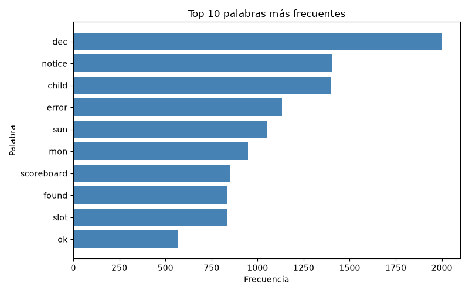
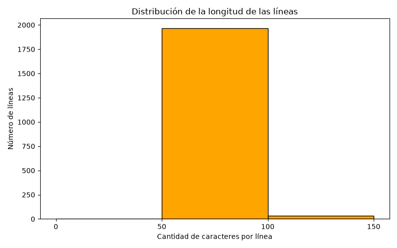
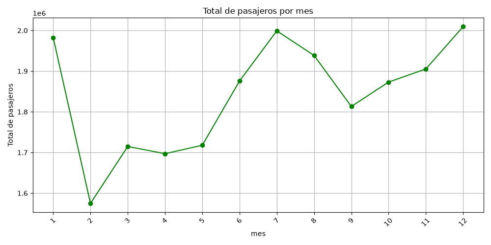
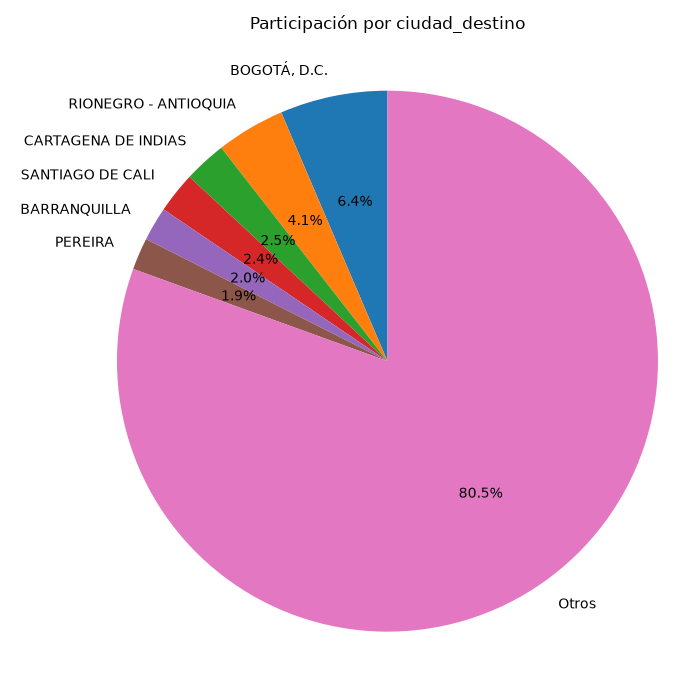
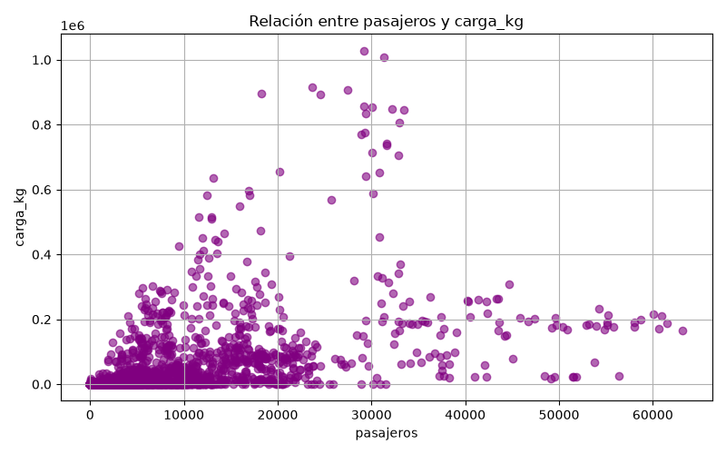

# Explorador CLI para el Análisis y Visualización de Archivos Reales

## 1. Descripción

Aplicación de consola (CLI) desarrollada en Python que permite explorar una carpeta, procesar archivos de texto (.txt) y analizar datasets (.csv) del mundo real. El programa calcula estadísticas descriptivas y genera cinco tipos de gráficos con matplotlib, a partir de los cuales se extraen conclusiones sobre los datos.

## 2. Análisis del problema

### 2.1 Planteamiento

Los datos reales casi nunca vienen listos para usar tienen celdas vacías, formatos distintos, miles de registros y pueden producir errores al leerse. El problema consiste en construir un programa que lea este tipo de archivos sin cerrarse ante errores, limpie la información, la resuma con estadísticas y la represente visualmente para que una persona pueda interpretarla.

### 2.2 Entradas

| Entrada | Descripción |
|---|---|
| Archivo .txt | Log de errores de un servidor web Apache. |
| Archivo .csv | Tráfico aéreo de Avianca en 2025 (Aerocivil). |
| Datos del usuario | Opciones de los menús, rutas de archivos, columnas a analizar y patrones a buscar. |

### 2.3 Procesos

1. **Lectura de archivos** con `with open()`, manejando errores con `try-except` (archivo inexistente o con codificación incorrecta).
2. **Limpieza de datos:** conversión de texto a número y descarte de valores vacíos o no numéricos.
3. **Análisis de texto:** conteo de líneas, caracteres y palabras (sin conectores) y búsqueda de patrones.
4. **Análisis numérico:** registros válidos, promedio, mediana, máximo y mínimo.
5. **Agrupación:** suma de valores por categoría (pasajeros por mes) y conteo de registros por categoría.
6. **Visualización:** cinco gráficos con título y ejes etiquetados.

### 2.4 Salidas

- Resultados en la consola (resúmenes y estadísticas).
- Cinco gráficos PNG en la carpeta `outputs/`.
- Archivo `outputs/coincidencias.txt` con las líneas encontradas al buscar un patrón.

### 2.5 Restricciones

- La única librería externa permitida es `matplotlib`. También se usan `os` y `csv`, que vienen incluidos con Python.
- El programa debe ser robusto: ninguna entrada inválida debe cerrarlo.

### 2.6 Decisiones de diseño

| Decisión | Justificación |
|---|---|
| Dividir el código en 4 archivos | Cada archivo tiene una responsabilidad: `main.py` (menú principal), `modulo_txt.py` (textos), `modulo_csv.py` (CSV) y `utilidades.py` (funciones compartidas). Así se evita repetir código y es más fácil encontrar errores. |
| `pedir_numero` con `while True` y `try-except` | El usuario solo avanza con un número válido y el programa nunca se cae por una entrada incorrecta. |
| Leer cada archivo una sola vez | Se lee antes de mostrar el submenú, todas las opciones usan los mismos datos en memoria. |
| Módulo `csv` en lugar de `split(",")` | Respeta valores que contienen comas entre comillas, como `"BOGOTÁ, D.C."`. |
| Codificación `utf-8-sig` en el CSV | Elimina un carácter invisible (BOM) que agregan Excel y Google Sheets al inicio del archivo. |
| Uso de `is not None` al filtrar números | Conserva los ceros, que son datos reales (rutas con 0 pasajeros). |
| Sumar por mes en el gráfico de tendencia | Cada fila es una ruta en un mes; sin agrupar, el gráfico tendría miles de puntos ilegibles. |
| Agrupar en "Otros" en el gráfico de pastel | Hay más de 100 categorías; se muestran las 6 principales y el resto se agrupa. |

---

## 3. Estructura del proyecto

```
Reto_unidad5/
├── venv/            → Ambiente virtual
├── main.py          → Menú principal
├── utilidades.py    → Funciones compartidas
├── modulo_txt.py    → Procesamiento de textos
├── modulo_csv.py    → Análisis de datasets
├── data/            → Archivos de datos reales
│   ├── apache_2k.txt
│   └── avianca_2025.csv
├── outputs/         → Gráficos y resultados generados
├── docs/            → Diagramas de flujo
└── README.md
```

---

## 4. Cómo ejecutar

1. Crear el ambiente virtual: `python -m venv venv`
2. Activarlo: `venv\Scripts\Activate.ps1`
3. Instalar matplotlib: `pip install matplotlib`
4. Ejecutar: `python main.py`

---

## 5. Datos utilizados

### 5.1 Dataset CSV: `avianca_2025.csv`

- **Origen:** Base de Datos Origen-Destino Enero-Diciembre 2025, publicada por la Aeronáutica Civil de Colombia (Aerocivil) en aerocivil.gov.co → Documentos → Bases de Datos → Origen-Destino → 2025. Las cifras son reportadas por las aerolíneas a la Aerocivil.
- **Qué representa:** cada fila es una **ruta de Avianca en un mes de 2025**, con los pasajeros y la carga transportados entre una ciudad de origen y una de destino.
- **Registros:** 13.133 filas.

| Columna | Significado |
|---|---|
| `mes` | Número del mes (1 = enero, 12 = diciembre). |
| `ciudad_origen` | Ciudad de salida. |
| `ciudad_destino` | Ciudad de llegada. |
| `trafico` | N = nacional, I = internacional. |
| `pasajeros` | Pasajeros transportados en esa ruta ese mes. |
| `carga_kg` | Carga y correo transportados, en kilogramos. |

- **Preparación:** el archivo original (formato Excel, con todas las aerolíneas) se abrió en Google Sheets. Se filtró la sigla **AVA** (Avianca), se conservaron 6 columnas, se renombraron los encabezados, se quitaron los separadores de miles, se reemplazaron los guiones (`-`, que significan cero) por `0` y se exportó como CSV.

### 5.2 Archivo de texto: `apache_2k.txt`

- **Origen:** muestra de 2.000 líneas del log de errores de un servidor web Apache, tomada del repositorio académico Loghub (github.com/logpai/loghub).
- **Qué representa:** cada línea es un evento registrado por el servidor, con fecha y hora, un nivel (`[notice]` para avisos normales o `[error]` para errores) y un mensaje.

---

## 6. Gráficos generados

### Gráfico 1 – Top 10 palabras más frecuentes (barras horizontales)


### Gráfico 2 – Distribución de la longitud de las líneas (histograma)


### Gráfico 3 – Total de pasajeros por mes (líneas)


### Gráfico 4 – Participación por categoría (pastel)


### Gráfico 5 – Relación entre pasajeros y carga (dispersión)


---

## 7. Resultados

### 7.1 Estadísticas de la columna `pasajeros`

| Medida | Valor |
|---|---|
| Registros válidos | 13.133 (0 descartados) |
| Promedio | 1.682,84 pasajeros por ruta al mes |
| Mediana | 82 pasajeros por ruta al mes |
| Máximo | 63.192 |
| Mínimo | 0 |

---

## 8. Conclusiones

1. **El tráfico de Avianca sigue las temporadas de vacaciones.** El total mensual de pasajeros alcanzó sus valores más altos en diciembre (aprox. 2,01 millones), julio (aprox. 2,0 millones) y enero (aprox. 1,98 millones), meses que coinciden con las vacaciones de fin de año y de mitad de año en Colombia. El mes más bajo fue febrero (aprox. 1,57 millones), justo después de la temporada alta, y septiembre también mostró una caída (aprox. 1,81 millones).

2. **El tráfico está muy concentrado en pocas rutas.** El promedio fue de 1.682 pasajeros por ruta al mes, pero la mediana fue de solo 82. Que el promedio sea unas 20 veces mayor que la mediana indica que la mitad de los registros mueve 82 pasajeros o menos, mientras que unas pocas rutas muy grandes (con un máximo de 63.192 pasajeros en un mes) elevan el promedio. Por eso, en este caso la mediana representa mejor a una ruta típica que el promedio.

3. **Más pasajeros no significa más carga.** El gráfico de dispersión no forma una tendencia diagonal. Las rutas con más pasajeros (entre 40.000 y 60.000 al mes) transportaron poca carga, cerca de 200.000 kg, mientras que algunas rutas con tráfico medio (entre 20.000 y 35.000 pasajeros) movieron hasta 1 millón de kg. Esto sugiere que la carga se concentra en rutas específicas, sin depender de cuántos pasajeros viajan en ellas.

4. **El log del servidor tiene una estructura muy uniforme.** Aproximadamente el 98 % de las líneas mide entre 50 y 100 caracteres, porque todas siguen el mismo formato: fecha, nivel y mensaje. Del total de 2.000 líneas.

5. **En el grafico de pastel podemos analizar los lugares a los que mas se han concurrido.** De los lugares mas concurridos son otros con destinos internacionales, esto lo explicaría debido a el intercambio de cargas y turistas que van a dichos lugares en cuanto a lugares locales el mas concurrido es Bogotá 
---

## 9. Limitaciones

- Las cifras de la Aerocivil son reportadas por las aerolíneas y pueden tener carácter provisional.
- El gráfico de pastel cuenta registros (rutas por mes), no la cantidad de pasajeros de cada categoría.
- El log de Apache es una muestra de 2.000 líneas de un servidor de 2005; sirve para analizar patrones, no el estado actual de un servidor.
- Los valores de los meses en la conclusión 1 son aproximados, leídos del gráfico.

---

## 10. Diagramas de flujo

Los diagramas están en la carpeta `docs/`, organizados por módulo:

- **Modulo 1 - main**
  - `Main.py.drawio.png` – Menú principal
  - `Explorar_directorio.drawio.png`
- **Modulo 2 - utilidades**
  - `Utilidades.py_pedir_numero.drawio.png`
- **Modulo 3 - txt**
  - `Menu_txt.drawio.png` – Submenú de textos
  - `Contar_palabras.drawio.png`
  - `Extraer_patrones.drawio.png`
- **Modulo 4 - csv**
  - `Menu_csv.drawio.png` – Submenú de datasets
  - `leer_csv.drawio.png`
  - `estadisticas.drawio.png`

---

## 11. Video de sustentación

https://drive.google.com/file/d/1jHVlHjpDSJwn_HCTB609iZ8j39mnGayY/view?usp=sharing

NOTA: El video no cuenta con previsualización por lo que se debe de descargar el archivo mp4 para su visualización y revisión  

---

## 12. Referencias

- Aeronáutica Civil de Colombia. *Base de Datos Origen-Destino Enero-Diciembre 2025.* aerocivil.gov.co
- Zhu, J. et al. *Loghub: A Large Collection of System Log Datasets for AI-driven Log Analytics.* github.com/logpai/loghub
